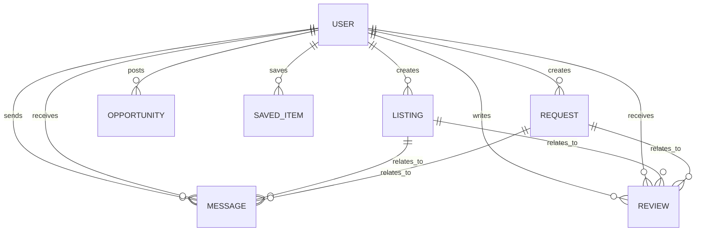

# UniSwap+

### Campus Resource, Skill & Opportunity Network

**EC4307 – Web Application Development Mini Project**  
**Student:** Mohamed Afrin  
**Registration No:** EG/2023/5466  

UniSwap+ is a campus-focused web application where students can share resources, offer skills, post requests, discover opportunities, save useful posts, message other students, and leave reviews.

The project was developed using the **MERN stack** with a main focus on complete CRUD operations, persistent database storage, validation, usability, and a responsive interface.

---

## Features

- User registration and login
- Create, view, edit, and delete listings
- Create, view, edit, and delete requests
- Search, filter, and sort campus posts
- Smart matching between listings and requests
- Direct messaging between users
- Reviews and user ratings
- Saved/bookmarked items
- Campus opportunities
- Campus advertisements
- User profile management
- Light and dark themes
- Responsive design for different screen sizes

---

## CRUD Operations

The two main entities in the project are **Listings** and **Requests**.

| Operation | Listings | Requests |
|---|:---:|:---:|
| Create | ✅ | ✅ |
| Read | ✅ | ✅ |
| Update | ✅ | ✅ |
| Delete | ✅ | ✅ |

Only the owner of a listing or request can edit or delete it.

---

## Technology Stack

| Area | Technology |
|---|---|
| Frontend | React, Vite, React Router, Axios, CSS |
| Backend | Node.js, Express.js |
| Database | MongoDB, Mongoose |
| Authentication | JWT, bcryptjs |
| API | REST API |

---

## How UniSwap+ Works

```text
React Frontend
      │
      │ REST API
      ▼
Node.js + Express Backend
      │
      │ Mongoose
      ▼
    MongoDB
```

The React frontend handles the interface, while the Express backend manages authentication, validation, CRUD operations, matching logic, and communication with MongoDB.

---

## Database

The application uses the following MongoDB collections:

- `users`
- `listings`
- `requests`
- `opportunities`
- `messages`
- `reviews`
- `saveditems`
- `advertisements`

A detailed description is available in [`database/schema.md`](database/schema.md).

---

## ER Diagram



---

## Smart Matching

UniSwap+ compares listings and requests using category, tags, and keywords.

```text
Match Score =
(shared tags × 2)
+ same category
+ (keyword overlap × 0.5)
```

The highest-scoring related posts are displayed first.

---

## Project Structure

```text
uniswap-plus/
├── backend/
│   ├── config/
│   ├── data/
│   ├── middleware/
│   ├── models/
│   ├── routes/
│   ├── scripts/
│   ├── utils/
│   ├── .env.example
│   ├── package.json
│   └── server.js
├── frontend/
│   ├── src/
│   │   ├── api/
│   │   ├── components/
│   │   ├── context/
│   │   ├── pages/
│   │   ├── styles/
│   │   └── App.jsx
│   ├── .env.example
│   └── package.json
├── database/
│   └── schema.md
├── .gitignore
└── README.md
```

---

## Installation and Setup

### Requirements

- Node.js
- npm
- MongoDB
- Git

### 1. Clone the repository

```bash
git clone https://github.com/YOUR-USERNAME/uniswap-plus.git
cd uniswap-plus
```

### 2. Backend

```bash
cd backend
npm install
```

Create `backend/.env` from `.env.example`:

```env
PORT=5000
MONGO_URI=mongodb://127.0.0.1:27017/uniswap_plus
JWT_SECRET=your_secret_key
JWT_EXPIRES_IN=7d
CLIENT_ORIGIN=http://localhost:5173
```

Seed the demo data:

```bash
npm run seed
```

Start the backend:

```bash
npm run dev
```

### 3. Frontend

Open another terminal:

```bash
cd frontend
npm install
```

Create `frontend/.env` from `.env.example`:

```env
VITE_API_URL=http://localhost:5000/api
```

Start the frontend:

```bash
npm run dev
```

Open:

```text
http://localhost:5173
```

---

## Demo Login

```text
Email: afrin@uor.lk
Password: password123
```

Other demo accounts are available through the quick-login options on the Login page.

---

## Validation and Security

The project includes client-side and server-side validation, JWT-protected routes, bcrypt password hashing, ownership checks, delete confirmations, Mongoose schema validation, and centralized backend error handling.

---

## Screenshots

Add final screenshots inside:

```text
docs/screenshots/
```

Recommended screenshots:

- Landing page
- Login page
- Dashboard
- Explore page
- Listings CRUD
- Requests CRUD
- Smart matching
- Messages
- Dark mode

Example:

```md

```

---

## Author

**Mohamed Afrin**  
**Registration No:** EG/2023/5466  
**Module:** EC4307 – Web Application Development

---

UniSwap+ was developed as an academic mini project to demonstrate full-stack web application development using the MERN stack.
