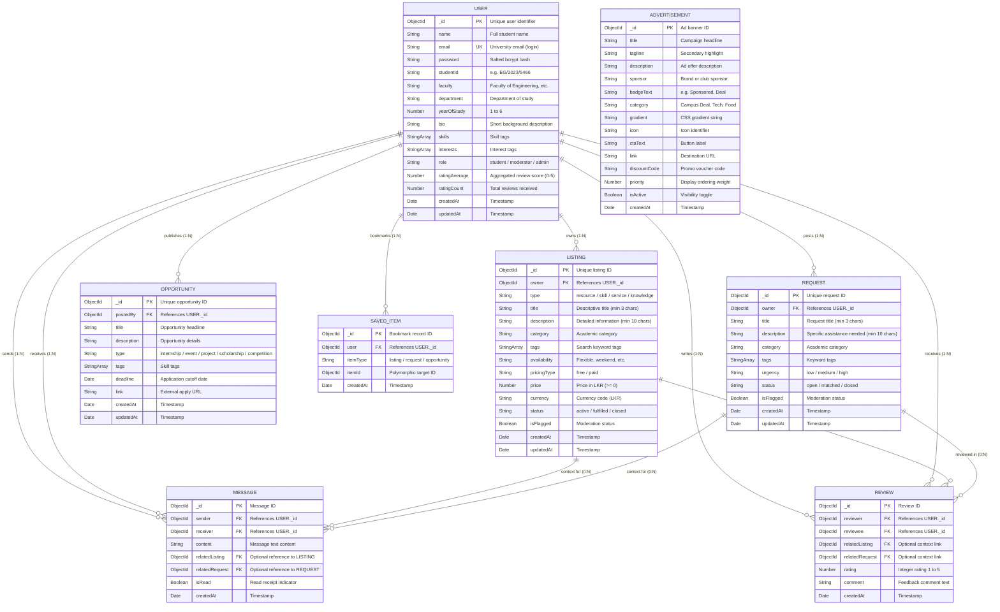

# UniSwap+ — Database Design & Schema Specification

**Course Module:** EC4307 Web Application Development  
**Mini Project:** UniSwap+ (Campus Resource & Skill Exchange Network)  
**Database Engine:** MongoDB v6+ (Document Store) with Mongoose v8+ ODM  
**Target Entities:** Users, Listings, Requests, Opportunities, Messages, Reviews, SavedItems, Advertisements  

---

## 1. Entity Relationship Diagram (ERD)

The following Mermaid ER Diagram models the persistent data structures, primary keys, foreign key references, and relational cardinalities between all 8 system entities:

---

## 2. Relational Modeling & Database Design Strategy

### 2.1 Hybrid Document-Relational Architecture
While MongoDB is fundamentally a NoSQL document database, our application requires relational integrity for student identities, ownership chains, and trust metrics. Therefore, we utilize **Mongoose ObjectIds with Schema references (`ref`)**:
- Each entity has an immutable Primary Key `_id` of type `Schema.Types.ObjectId`.
- Foreign Keys are stored as ObjectIds referencing parent documents (e.g. `Listing.owner -> User._id`, `Message.sender -> User._id`).
- Mongoose `.populate()` is utilized on `GET` endpoints to hydrate foreign references (e.g. embedding the owner's `name`, `department`, and `ratingAverage` onto listing cards without redundant denormalization).

### 2.2 Indexing & Constraint Enforcement
1. **Unique Indices**:
   - `User.email`: Unique index ensures that no duplicate accounts can register with the same institutional address.
   - `SavedItem (user, itemType, itemId)`: Compound unique index prevents a student from bookmarking the exact same item multiple times.
2. **Sort & Query Indices**:
   - `Listing.status` and `Listing.createdAt`: Indexed to optimize sorting on the Explore and Home feeds.
   - `Request.status` and `Request.createdAt`: Indexed for fast retrieval of open community requests.
3. **Cascading & Safety Rules**:
   - Deleting a listing or request verifies ownership on both client and server before deleting.
   - Messages and reviews maintain reference integrity by treating context links as nullable.

---

## 3. Data Dictionary

### Collection: `users`
Represents registered university students, researchers, or authorized moderators.

| Field Name | Data Type | Constraint | Default | Description |
|---|---|---|---|---|
| `_id` | ObjectId | Primary Key | Auto | Unique identifier |
| `name` | String | Required, Trim | - | Full name of the student |
| `email` | String | Required, Unique, Lowercase | - | Institutional email for authentication |
| `password` | String | Required | - | Bcrypt hashed password (10 salt rounds) |
| `studentId` | String | Trim | - | University Registration ID (e.g. EG/2023/5466) |
| `faculty` | String | Trim | - | Faculty affiliation (e.g. Faculty of Engineering) |
| `department` | String | Trim | - | Department of study |
| `yearOfStudy` | Number | Min 1, Max 6 | - | Current undergraduate or postgraduate academic year |
| `bio` | String | Trim | `""` | Personal summary & collaboration bio |
| `skills` | Array of String | Trimmed | `[]` | Skills offered for peer matching |
| `interests` | Array of String | Trimmed | `[]` | Academic and project interests |
| `avatarColor` | String | Hex Code | `#2B3A67` | Avatar badge accent background |
| `role` | String | Enum: `student`, `moderator`, `admin` | `student` | Role-based access control level |
| `isVerified` | Boolean | Boolean | `true` | University verification check |
| `ratingAverage`| Number | 0.0 to 5.0 | `0` | Computed average of all completed reviews |
| `ratingCount` | Number | Integer >= 0 | `0` | Total number of student reviews received |
| `createdAt` | Date | Timestamp | Now | Record creation timestamp |
| `updatedAt` | Date | Timestamp | Now | Record modification timestamp |

---

### Collection: `listings` (Main CRUD Entity 1)
Student-created offers including equipment/resources, technical skills, services, or study guides.

| Field Name | Data Type | Constraint | Default | Description |
|---|---|---|---|---|
| `_id` | ObjectId | Primary Key | Auto | Unique listing identifier |
| `owner` | ObjectId | Required, Ref: `User` | - | Foreign key to the creating student |
| `type` | String | Enum: `resource`, `skill`, `service`, `knowledge` | - | Category classification of exchange |
| `title` | String | Required, Min 3, Max 100 | - | Headline of the listing |
| `description` | String | Required, Min 10, Max 2000 | - | Comprehensive explanation of what is offered |
| `category` | String | Required, Trim | - | Topic (e.g. Engineering, Design, Tutoring) |
| `tags` | Array of String | Lowercase, Trim | `[]` | Search index tokens |
| `availability`| String | Trim | `"Flexible"` | Availability schedule / location |
| `pricingType` | String | Enum: `free`, `paid` | `"free"` | Whether item is free or requires payment |
| `price` | Number | Min 0 (if paid) | `undefined` | Amount in Sri Lankan Rupees (LKR) |
| `currency` | String | Trim | `"LKR"` | ISO currency code |
| `status` | String | Enum: `active`, `fulfilled`, `closed` | `"active"` | Operational status |
| `isFlagged` | Boolean | Boolean | `false` | Moderation trigger flag |
| `createdAt` | Date | Timestamp | Now | Auto timestamp |
| `updatedAt` | Date | Timestamp | Now | Auto timestamp |

---

### Collection: `requests` (Main CRUD Entity 2)
Public requests for academic assistance, borrowed gear, exam study groups, or project collaborators.

| Field Name | Data Type | Constraint | Default | Description |
|---|---|---|---|---|
| `_id` | ObjectId | Primary Key | Auto | Unique request identifier |
| `owner` | ObjectId | Required, Ref: `User` | - | Foreign key to the requesting student |
| `title` | String | Required, Min 3, Max 100 | - | Request title |
| `description` | String | Required, Min 10, Max 2000 | - | Detailed description of the need |
| `category` | String | Required, Trim | - | Domain topic |
| `tags` | Array of String | Lowercase, Trim | `[]` | Search and matching tokens |
| `urgency` | String | Enum: `low`, `medium`, `high` | `"medium"` | Priority level of the request |
| `status` | String | Enum: `open`, `matched`, `closed` | `"open"` | Workflow status |
| `isFlagged` | Boolean | Boolean | `false` | Moderation flag |
| `createdAt` | Date | Timestamp | Now | Auto timestamp |
| `updatedAt` | Date | Timestamp | Now | Auto timestamp |

---

### Collection: `opportunities`
Campus-wide internships, student hackathons, research positions, and society events.

| Field Name | Data Type | Constraint | Default | Description |
|---|---|---|---|---|
| `_id` | ObjectId | Primary Key | Auto | Unique opportunity ID |
| `postedBy` | ObjectId | Required, Ref: `User` | - | Foreign key to publisher |
| `title` | String | Required, Trim | - | Event or role title |
| `description` | String | Required, Trim | - | Full role requirements or agenda |
| `type` | String | Enum: `internship`, `event`, `project`, `scholarship`, `competition`, `other` | `"other"` | Opportunity category |
| `tags` | Array of String | Lowercase, Trim | `[]` | Skill & eligibility tags |
| `deadline` | Date | Optional | `null` | Application or registration deadline |
| `link` | String | Trim | `""` | Official external application URL |
| `createdAt` | Date | Timestamp | Now | Timestamp |

---

### Collection: `messages`
Real-time peer communication tied directly to listings or requests.

| Field Name | Data Type | Constraint | Default | Description |
|---|---|---|---|---|
| `_id` | ObjectId | Primary Key | Auto | Message record ID |
| `sender` | ObjectId | Required, Ref: `User` | - | User sending the message |
| `receiver` | ObjectId | Required, Ref: `User` | - | User receiving the message |
| `content` | String | Required, Trim | - | Message body text |
| `relatedListing`| ObjectId | Ref: `Listing` | `null` | Contextual reference to listing |
| `relatedRequest`| ObjectId | Ref: `Request` | `null` | Contextual reference to request |
| `isRead` | Boolean | Boolean | `false` | Whether receiver opened message |
| `createdAt` | Date | Timestamp | Now | Timestamp |

---

### Collection: `reviews`
Peer-to-peer accountability ratings (1–5) and feedback submitted upon exchange completion.

| Field Name | Data Type | Constraint | Default | Description |
|---|---|---|---|---|
| `_id` | ObjectId | Primary Key | Auto | Review record ID |
| `reviewer` | ObjectId | Required, Ref: `User` | - | Student submitting review |
| `reviewee` | ObjectId | Required, Ref: `User` | - | Student being evaluated |
| `rating` | Number | Required, Min 1, Max 5 | - | Quantitative rating score |
| `comment` | String | Trim | `""` | Qualitative review remarks |
| `relatedListing`| ObjectId | Ref: `Listing` | `null` | Associated listing |
| `relatedRequest`| ObjectId | Ref: `Request` | `null` | Associated request |
| `createdAt` | Date | Timestamp | Now | Timestamp |

---

### Collection: `saveditems`
Student bookmarks for quick reference.

| Field Name | Data Type | Constraint | Default | Description |
|---|---|---|---|---|
| `_id` | ObjectId | Primary Key | Auto | Bookmark ID |
| `user` | ObjectId | Required, Ref: `User` | - | User who saved the item |
| `itemType` | String | Enum: `listing`, `request`, `opportunity` | - | Type of bookmarked item |
| `itemId` | ObjectId | Required | - | Target entity ID |
| `createdAt` | Date | Timestamp | Now | Timestamp |

---

### Collection: `advertisements`
Curated student deals, campus cafeteria offers, and club notices.

| Field Name | Data Type | Constraint | Default | Description |
|---|---|---|---|---|
| `_id` | ObjectId | Primary Key | Auto | Unique banner ID |
| `title` | String | Required | - | Deal headline |
| `tagline` | String | Optional | - | Short promotional highlight |
| `description` | String | Required | - | Offer details and redemption steps |
| `sponsor` | String | Required | - | Organization or vendor name |
| `badgeText` | String | Default | `"Sponsored"` | Tag displayed in corner |
| `category` | String | Default | `"Campus Deal"`| Category grouping |
| `gradient` | String | CSS gradient | - | Visual aesthetic theme |
| `icon` | String | Icon name | `"Megaphone"` | Lucide icon identifier |
| `ctaText` | String | Default | `"Learn More"`| Action button label |
| `link` | String | Trim | `"#"` | Hyperlink destination |
| `discountCode` | String | Optional | `null` | Promo coupon code |
| `priority` | Number | Default | `0` | Ordering weight |
| `isActive` | Boolean | Default | `true` | Visibility control |
